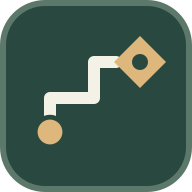

  

<h1 align="center">LAMBS Mission Framework</h1>

<strong>LMF 2.0 | Arma 3 Mission Framework</strong>

<a href="https://alexandertoftesund.github.io/lambs-mission-framework/">Mission Maker Guide</a>

LAMBS Mission Framework (LMF) is a reusable framework for building cooperative Arma 3 missions. It provides configurable AI, player equipment, logistics and mission systems so mission makers can focus on creating scenarios.

## Features

- **AI spawning:** Garrison, Patrol, Infantry QRF, Hunters, Vehicle QRF and Paradrop QRF, plus AI tasks.
- **Player equipment:** Configurable roles, loadouts, weapon pools, role selection and Personal Arsenal.
- **Logistics:** Supply crates, Supply Drops and ground/air vehicle spawning.
- **Mission systems:** Warmup, respawn, briefing, Blue Force Tracking, notifications and admin utilities.
- **Zeus integration:** AI reinforcements and mission support through optional ZEN modules.

## Getting started

1. **[Download LMF 2.0](https://github.com/alexandertoftesund/lambs-mission-framework/releases/latest)**.
2. Extract the package and copy `LMF_DEV.Altis` into your Arma 3 missions folder.
3. Open the included example mission in Eden Editor and adapt its settings and building blocks to your scenario.

The download includes the **LMF Mission Maker Guide** (HTML) with installation instructions, practical SQF examples and explanations of each feature. Optional Player and AI loadout examples are included alongside the mission.

For an existing mission, follow the guide's integration steps rather than replacing your `mission.sqm`.

## Requirements

- Arma 3 2.22 or newer
- CBA A3
- ACE3
- ACRE2

**Recommended:** LAMBS Danger FSM. **Optional:** ZEN for Zeus integration.

## Documentation

- [Mission Maker Guide](https://alexandertoftesund.github.io/lambs-mission-framework/)
- [Latest release](https://github.com/alexandertoftesund/lambs-mission-framework/releases/latest)
- [Changelog](CHANGELOG.md) - version history

---

*Made for the LAMBS community.*
